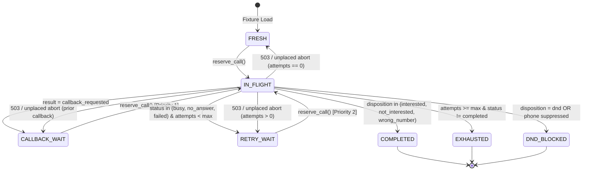

# Submission

## Candidate
- **Name:** Tejas Acharya C
- **Assignment chosen:** B (Workflow — Durable Campaign Dispatcher)
- **Time spent (honest estimate):** ~6.5h

## How to run
```bash
# 1. Environment Setup (from repository root)
python -m venv .venv

# On Linux / macOS:
source .venv/bin/activate
# On Windows (PowerShell):
# .\.venv\Scripts\Activate.ps1

pip install -r requirements.txt

# 2. Run the Mock Telephony Provider in the background
# (Option A: Clean baseline @ 2400x speed)
python -m mock_telephony --failure-scale 0 --speed 2400 --seed 7

# (Option B: Chaos mode @ 1200x speed)
# python -m mock_telephony --failure-scale 1.0 --speed 1200 --seed 42

# 3. In another terminal, run the Campaign Dispatcher to completion
python -m solution.app.main

# 4. Run the 24 unit and integration tests
pytest solution/tests/

# 5. Optional: Run the automated live end-to-end verification harness (clean or chaos with hard kill)
python solution/tests/verify_run.py --failure-scale 1.0 --speed 1200 --seed 42 --kill-after 4.0
```

## Design

The solution is architected as an asynchronous, crash-resilient single-process service that combines **FastAPI** (for inbound HMAC-verified webhooks), **asyncio** (for concurrent HTTP dispatching and reconciliation loops), and **SQLite with WAL mode and `synchronous=FULL`** (as the single source of truth for lead states, attempt records, global DND suppressions, and tenant concurrency allocations).

All state transitions and resource reservations execute under strict `BEGIN IMMEDIATE` write transactions (`solution.app.database.write_tx`). Because transactions run with `check_same_thread=False` and a 5000ms busy timeout, webhooks and dispatcher coroutines never interleave conflicting updates or observe dirty state.

### Lead State Machine



### At-Most-Once Dialing Guarantee (Two-Phase Intent Pattern)

To guarantee that no duplicate or unlawful calls are ever placed:
1. **Pre-Dial Intent Reservation:** Before making an outbound HTTP request, `reserve_call()` atomically validates all business constraints inside `BEGIN IMMEDIATE`:
   - Tenant concurrency: `COUNT(call_attempts WHERE tenant_id = ? AND state IN ('PENDING_DISPATCH', 'ACTIVE')) < tenant.max_concurrent_calls`
   - Active phone exclusion: No active or pending call exists for the same phone number. This is backed by a partial unique index in SQLite:
     ```sql
     CREATE UNIQUE INDEX idx_call_attempts_active_phone 
     ON call_attempts(phone) WHERE state IN ('PENDING_DISPATCH', 'ACTIVE');
     ```
   - Calling window and global DND suppressions are re-validated.
   - Lead transitions to `IN_FLIGHT` and a `call_attempts` record is inserted with `state = 'PENDING_DISPATCH'` and `request_id = uuid4()`.
2. **Pre-Dial Calling Window Guard:** Right before invoking `POST /v1/calls`, the dispatcher checks `in_calling_window(sim_clock.now(), ...)` using `effective_safety_margin_sec`. If event-loop latency pushed the simulated clock past the safety margin, the attempt is immediately aborted (`abort_unplaced_attempt`) without sending the HTTP request.
3. **Provider Call Placement:** `POST /v1/calls` is executed with the idempotency key `request_id`.
   - On `201 Created`: Transitions `call_attempts` to `ACTIVE` with `call_sid`.
   - On `503 Service Unavailable`: Aborts attempt locally, releasing concurrency and resetting the lead state.
   - On `504 Gateway Timeout` or Network Disconnect: Leaves attempt as `PENDING_DISPATCH`. The background reconciler polls `GET /v1/calls?request_id={rid}`. If the provider accepted the call, it adopts `call_sid`; if the provider returns 404, it safely aborts the attempt.
   - On Process Crash (`kill -9` / `taskkill /F`): On restart, `reconcile_attempts(startup=True)` reconciles all orphaned `PENDING_DISPATCH` and stale `ACTIVE` calls against the provider before resuming dialing.

## Decisions & assumptions

| Decision | Why | Alternative considered |
|---|---|---|
| **SQLite WAL state machine vs. Temporal** | Single-node assignment requirements fit cleanly into SQLite WAL (`PRAGMA synchronous = FULL; BEGIN IMMEDIATE`). Provides zero external infrastructure dependencies, sub-millisecond local transactions across leads, attempts, DND suppressions, and webhook receipts. | Temporal workflow engine. Rejected because running Temporal server, PostgreSQL persistence, and worker clusters introduces heavy external operational overhead for an embedded assignment. |
| **Speed-scaled window safety margin (`effective_safety_margin_sec`)** | At high simulation speeds (1200x–2400x), ~100–200ms of real-world network and context-switching latency translates to 120–480 simulated seconds. Scaling the safety margin dynamically (`max(settings.window_safety_margin_sec, int(speed * 0.30))`) ensures calls are never placed outside the calling window even with network jitter. | Static 15s margin. Proved too small under 1200x simulation speed during chaos tests, resulting in a 2-second overshoot against the provider's 120s grace period. |
| **Webhook deduplication keyed on `(call_sid, request_id)`** | The telephony provider creates a new UUID `X-AU-Delivery-Id` header for each retry/duplicate delivery attempt. Deduplicating on delivery ID would allow duplicate processing. Keying deduplication on `call_sid` / `request_id` guarantees exact idempotency. | Deduplicating via `X-AU-Delivery-Id`. Rejected because duplicates have distinct delivery IDs. |
| **Stale `ACTIVE` call polling threshold at 410 simulated seconds** | In `mock_telephony`, maximum call duration is 30s ring + 360s talk = 390s. If a call has been in `ACTIVE` state for >410 simulated seconds without a webhook arriving, the webhook was lost. Polling `GET /v1/calls/{call_sid}` recovers the result cleanly. | Continuous polling of all active calls. Rejected to prevent overloading provider API with redundant traffic. |
| **Strict terminal status precedence** | In edge cases where a call completes with an interested/not_interested disposition on its final allowed attempt, `completed` must take precedence over `exhausted` or `dnd_blocked`. | Ordering precedence as exhausted > completed. Rejected because successful conversions must be credited even on the last attempt. |

## Failure modes considered

- **Provider 503 Service Unavailable:** The provider randomly returns 503 under chaos mode. Caught directly in `telephony.py` without throwing an unhandled exception; `abort_unplaced_attempt()` cleans up the reservation, rolls back lead attempts, and restores lead to eligible status.
- **Provider 504 Gateway Timeout / Network Disconnect:** The HTTP connection drops before receiving a response, leaving call placement status ambiguous. Treated as pending: `reconcile_attempts()` queries `GET /v1/calls?request_id=...` to resolve whether the call was actually placed or dropped.
- **Duplicate Webhooks:** Telephony provider delivers duplicates under chaos mode. Handled idempotently in `apply_call_result()`: if `call_attempts.state` is already `COMPLETED`, the incoming duplicate is acknowledged with `200 OK` and ignored without double-counting attempts or transitioning leads.
- **Early Webhooks Arriving Before `201` Response:** Under high concurrency, an ended call webhook can arrive at `POST /webhooks/telephony` before `POST /v1/calls` returns `201` to the client. The webhook receiver locates the attempt by `request_id` or `call_sid` and records completion regardless of whether `call_sid` was previously written.
- **Lost Webhooks:** The provider randomly drops webhooks (`W.webhook_stats["lost"]`). The background reconciler scans for calls in `ACTIVE` state exceeding 410 simulated seconds and retrieves their outcome via `GET /v1/calls/{call_sid}`.
- **Global DND Race Conditions:** If lead A and lead B share the same phone number and lead A opts into DND, lead A's webhook commits phone suppression to `phone_suppressions` in the same atomic transaction. Any in-flight reservation for lead B immediately detects the suppression and aborts.
- **Mid-Run Hard Kill (`kill -9` / `taskkill /F`):** On process restart, the dispatcher runs `reconcile_attempts(startup=True)` before any new call reservation. Orphaned `PENDING_DISPATCH` calls are resolved against the provider, and active calls resume tracking.
- **Known Limitations:** The SQLite write lock (`BEGIN IMMEDIATE`) restricts state mutations to a single process. Scaling horizontally across multiple worker nodes would require transitioning to PostgreSQL with row-level locking (`SELECT ... FOR UPDATE SKIP LOCKED`).

## Testing

### Automated Unit & Integration Tests (`pytest solution/tests/`)
A comprehensive suite of **24 tests** runs in ~1.2s without real-time sleeps:
- `test_loader.py` (5 tests): Verifies idempotent loading of 2 tenants, 3 campaigns, 200 leads, schema initialization, and pre-existing DND phone suppressions.
- `test_rules_and_window.py` (7 tests): Tests `SimClock` and `FakeClock`, window boundaries (inclusive start, exclusive end, safety margin cutoffs, weekend and day restrictions, regulatory clamping), multi-day forward window search, retry backoffs, callback scheduling, and HMAC-SHA256 signature verification.
- `test_scheduler_and_state.py` (6 tests): Validates atomic `reserve_call()` constraints, tenant capacity enforcement, partial unique index concurrency locks, priority scheduler ordering (`CALLBACK_WAIT` > `RETRY_WAIT` > `FRESH`), terminal disposition handling, and global DND propagation.
- `test_recovery_and_reporting.py` (6 tests): Tests 503 unplaced aborts, 504 reconciliation, lost webhook recovery via `GET /v1/calls/{call_sid}`, terminal status determination, and sorted CSV emission matching required headers and columns.

### Live End-to-End Tests (`solution/tests/verify_run.py`)
- **Clean Run:** `--failure-scale 0 --speed 2400 --seed 7` -> 407 calls placed, 0 violations, 200/200 exact CSV match.
- **Chaos + Hard Kill Run:** `--failure-scale 1.0 --speed 1200 --seed 42` with `kill -9` / `taskkill /F` at 4.0s mid-run -> 408 calls placed, 0 violations, 200/200 exact CSV match.

## Results

Exact `/admin/report` JSON from the mid-run hard kill chaos run (`--failure-scale 1.0 --speed 1200 --seed 42`):
```json
{
  "sim_now": "2026-11-17T10:44:35.085354+05:30",
  "calls_total": 408,
  "calls_active": 0,
  "calls_by_status": {
    "completed": 228,
    "no_answer": 104,
    "failed": 25,
    "busy": 51
  },
  "violation_count": 0,
  "violations_by_type": {},
  "violations": [],
  "max_concurrency_seen": {
    "acme_insurance": 4,
    "zen_retail": 3
  },
  "callback_lateness_minutes": {
    "count": 71,
    "p50": 9.6,
    "p90": 23.8,
    "max": 2345.2
  },
  "webhooks": {
    "delivered": 435,
    "connect_errors": 4,
    "duplicates": 35,
    "lost": 8
  }
}
```
- **Total Rows in `final_state.csv`:** 200
- **Total Expected Leads from `/admin/leads`:** 200
- **Lead Mismatches:** 0
- **Business Rule Violations:** 0

## If I had another day

1. **Event-Driven Dispatcher Wakeups:** Replace the 50ms polling loop with an `asyncio.PriorityQueue` / timer wheel of scheduled lead wakeups (targeting exact `next_eligible_at` and window open instants) triggered reactively by incoming webhooks to minimize `callback_lateness_minutes`.
2. **PostgreSQL Multi-Worker Support:** Migrate from SQLite to PostgreSQL using `SELECT ... FOR UPDATE SKIP LOCKED` and advisory locks, enabling multiple dispatcher worker processes to run horizontally behind a load balancer.
3. **Structured Observability & OpenTelemetry Metrics:** Add Prometheus metrics and OpenTelemetry distributed tracing spans across `POST /v1/calls`, webhook processing, and reconciliation passes to track dialing latency and error rates in real time.
